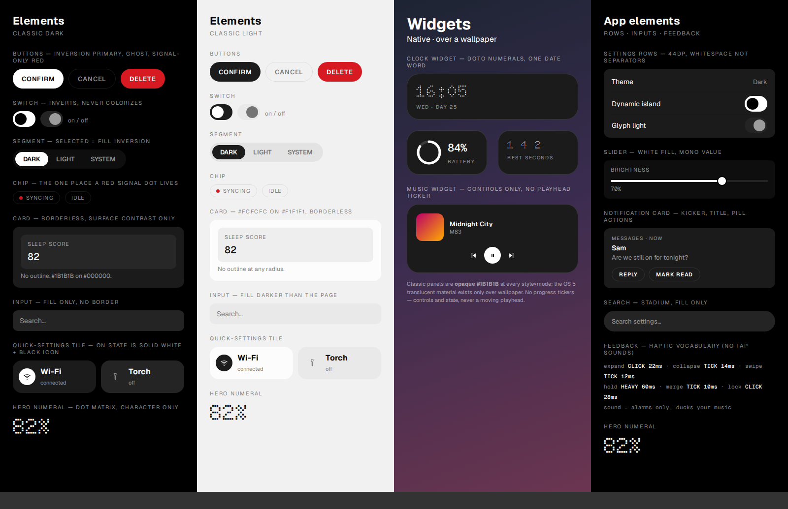

# Nothing OS Design — measured spec

A pixel-measured, source-checked design specification for building apps and
themes in the **Nothing OS / Nothing OS 5** visual language.

Nothing publishes no official design-token spec. Everything here was either
taken from Nothing's own materials (labeled **[official]**) or measured
pixel-by-pixel from a real Nothing OS 5 device and a working reference
implementation (labeled **[impl]**). Every claim is audited in
[`docs/fact-check.md`](docs/fact-check.md) with sources.

> **Not affiliated with Nothing Technology Ltd.** "Nothing OS" and related
> marks belong to their owner. No Nothing proprietary assets (NDot, NType,
> Lettera fonts, icon artwork) are included or shipped — only open-licensed
> stand-ins are recommended.

*Element gallery — dark & light elements, native widgets (clock, battery
ring, media controls) over a wallpaper, app rows/sliders/notifications, and
the haptic vocabulary. Interactive version:
[`docs/mockup-elements.html`](docs/mockup-elements.html)*

## Highlights — the parts everyone gets wrong

1. **Active states invert, they don't colorize.** On a real device: switch ON =
   white track/black knob, selected segment = grey-on-grey, QS tiles that are
   on are solid **#FFFFFF with black icons**. Color is not how this OS says
   "active".
2. **The accent is a signal, not a style.** Nothing red **#D71921** (measured
   exactly on-device) appears ~0–2 times per screen: destructive, live,
   error, needs-attention. Never on primary buttons, tabs, or links.
3. **The OS 5 "Translucent" material never frosts app pages.** Measured with
   the Translucent style active system-wide: Settings/quick settings stay
   solid `#1B1B1B` on true `#000000`. Translucency exists only over the
   wallpaper (home screen).
4. **The OS 5 color engine reaches the icon layer.** On a blue wallpaper the
   same home icon that is `#D71921` red in Classic renders `#1294D2` — the
   personalization hue replaces signal-colored icons, while system UI stays
   monochrome.
5. **Geometry is mode- and style-invariant.** Measured identical radii/rows
   across dark/light × Classic/Translucent (settings cards 25px @720 ≈ 13dp,
   rows 88px, QS tile gaps ~40px). Mode = color swap only.
6. **Interaction feedback is haptic, never audible.** The click you "hear" on
   a Nothing phone is the vibration motor. A Nothing-styled app carries a
   small fixed haptic vocabulary and reserves sound for alarms — ducked, so
   the user's music never stops. See
   [`docs/feedback.md`](docs/feedback.md).

## Examples — widgets & app elements

Concrete recipes (full tables in
[`docs/tokens.md`](docs/tokens.md) and
[`docs/components.md`](docs/components.md); rendered in the gallery above):

| Element | Recipe |
|---|---|
| Clock widget | Doto (or NDot JP) numerals ~34px, weight ≈500, one date word in 10px uppercase +0.16em dim; panel opaque `#1B1B1B`, 24dp radius, `#1FFFFFFF` hairline (native) |
| Battery ring | ring stroke 5dp — track white 14%, fill white with round caps, % in Geist Mono 22px beside it; white ring = data encoding, never accent red |
| Media widget | artwork 56dp radius 12, title 13/600, artist 11 dim, controls: prev/next 15dp glyphs, play/pause = white 34dp circle with black glyph; **no playhead ticker** (a per-second widget update is pure battery loss) |
| Settings rows | 44dp min-height, label 14/400, value 13 dim, borderless card radius 13, separation by whitespace; switches invert (white track/black knob) |
| Slider | 4px track, white fill to the value, 16px white thumb; value in Geist Mono, label uppercase +0.1em dim |
| Notification card | kicker (app · time) 10px uppercase dim, title 14/600, body 13 dim, actions as ghost pills (hairline + 11/600 uppercase) |
| Search bar | stadium, fill = elevated surface, no border, placeholder dim |
| Haptic vocabulary | expand CLICK 22ms/150 · collapse TICK 14ms/110 · swipe TICK 12ms/130 · hold HEAVY_CLICK 60ms/200 · merge TICK 10ms/90 · lock CLICK 28ms/100; strength scales amplitude only |

## Contents

| File | What's in it |
|---|---|
| [`docs/tokens.md`](docs/tokens.md) | Full token tables: brand palette, classic dark/light, OS 5 deltas, complete 2×2 style×mode matrix, accent decision table — all measured values |
| [`docs/typography.md`](docs/typography.md) | Font roles & stacks, per-element type scale (size/weight/tracking), Nothing's official leading/tracking specs, device-measured OS 5 system-UI scale with a multi-device cross-check |
| [`docs/components.md`](docs/components.md) | Buttons, switches, chips, lists, alerts, dot-matrix icon construction (9×9 / 25×25), media-player patterns, motion, accessibility |
| [`docs/feedback.md`](docs/feedback.md) | Haptics & sound: platform APIs, the semantic haptic vocabulary, alarm-only sound with audio ducking, Glyph Developer Kit notes |
| [`docs/third-party-case-studies.md`](docs/third-party-case-studies.md) | Source-checked study of a second shipped implementation ([MissingCore/Music](https://github.com/MissingCore/Music)) — palette cross-checks, accent ramps, media-player patterns |
| [`docs/fact-check.md`](docs/fact-check.md) | Claim-by-claim audit with verdicts and sources — the credibility layer |
| [`docs/screenshots/`](docs/screenshots/) | Sanitized reference screenshots covering all four style×mode combinations |
| [`skill/SKILL.md`](skill/SKILL.md) | The same spec packaged as a [Hermes Agent](https://hermes-agent.nousresearch.com/docs) skill (drop-in for agent use) |

## Methodology

Measurements were taken from on-device screenshots (720×1600) by sampling
pixel colors at known element positions, fitting corner radii by scanning
edge insets and least-squares fitting a circle, and cross-checking dominant
colors per region. Device-under-test ran Nothing OS 5.0 (Android 17). A
second measurement pass (2026-11-28) validated the type scale against
independent OS 5 devices from web sources (`docs/screenshots/web/` —
Phone (3) / (3a) / (2a), sources in SOURCES.md there) and Nothing X 2.1.1
on a 420 dpi emulator; per-device density evidence and uncertainty bands
are documented in `docs/typography.md`. Values
labeled [impl] come from two production app implementations that have
shipped through multiple releases: the
[dashbord](https://github.com/Jero009/dashbord) app
(`src/theme/variables.css`) and the
[Essential Island](https://github.com/Jero009/essential-island) overlay app
(haptic vocabulary, `util/HapticStyle.kt`).

Primary sources: Nothing OS 5.0 announcement (nothing.community, 2026-08-25),
nothing.tech OS 5 page, nothing.wiki brand reference, Vercel Geist / Google
Fonts Doto / Florian Karsten Space Grotesk licensing pages.

Values are additionally cross-checked against a second shipped third-party
implementation, [MissingCore/Music](https://github.com/MissingCore/Music)
(AGPL-3.0) — an independent Nothing-inspired app whose source was read (not
copied) for the 2026-11-25 cross-check; see
[`docs/third-party-case-studies.md`](docs/third-party-case-studies.md).

## Fonts (legal note)

Nothing's own typefaces are proprietary brand assets — **do not ship them**.
The real faces are **NDot 55** (logotype & product names only), **NDot 57**
(deprecated ~2022), the **NType82** family, and **Lettera Mono LL** (Colophon
Foundry, © Nothing Technology Ltd) — none is licensed for reuse. Note that
**Doto is not a Nothing font**: it never appears in any Nothing app or promo
material. It is an independent open-source face (Óliver Lalan, Google Fonts,
SIL OFL 1.1) chosen as the closest legal stand-in for Nothing's dot-matrix
role. The spec uses these open (SIL OFL 1.1) stand-ins:

| Role | Classic | OS 5 |
|---|---|---|
| Body / headings | Space Grotesk | Geist |
| Numerics | Doto | Geist Mono |

## Using it

- **Designing an app/theme**: start with `docs/tokens.md`, follow the accent
  decision table, check your result against the guardrails in the Highlights.
- **Building it**: grab [`docs/tokens.css`](docs/tokens.css) (drop-in custom
  properties) or [`docs/tokens.json`](docs/tokens.json) (any tool that reads
  design tokens) — values are labeled official/impl.
- **Agent use**: copy `skill/` into your Hermes skills directory.
- **Verifying a claim**: `docs/fact-check.md` lists the verdict and source for
  every load-bearing number.

## Share & community

- **Live site**: https://jero009.github.io/nothing-os-design/ (this spec,
  served straight from `docs/`)
- **Interactive gallery**: https://jero009.github.io/nothing-os-design/mockup-elements.html
- **Feedback & ideas**: [GitHub Discussions](https://github.com/Jero009/nothing-os-design/discussions)
  — measured corrections especially welcome; bring a screenshot and the
  claim will be audited like every other number.
- **Versioned**: each spec revision ships as a release
  ([latest](https://github.com/Jero009/nothing-os-design/releases)) — pin a
  version instead of tracking `main`.

## AI disclosure

This spec was produced **with heavy AI assistance**. It is authored and
maintained by Jernej Peter working with an AI coding agent
([Hermes Agent](https://hermes-agent.nousresearch.com/docs)), which drafted
the documents, extracted and cross-checked values from public app sources,
built the element gallery and this site, and handled releases.

- **Every load-bearing number is audited** in
  [`docs/fact-check.md`](docs/fact-check.md) with its source — that audit
  layer exists precisely because AI drafted the claims. Treat nothing as
  true because the spec says so; check the audit.
- Device measurements came from screenshots taken by a human on a real
  Nothing OS 5 phone. Third-party cross-checks were read from public source
  code, with file paths cited in the docs.
- Direction, review, and every commit and release decision were
  human-approved before publishing.

## License

MIT — see [LICENSE](LICENSE). Screenshots are provided as design reference
for the measured values; Nothing OS UI depicted remains © Nothing Technology
Ltd.
